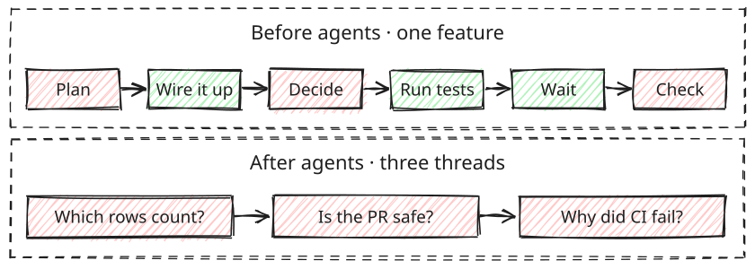
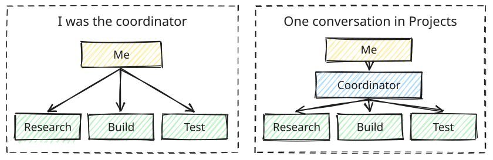
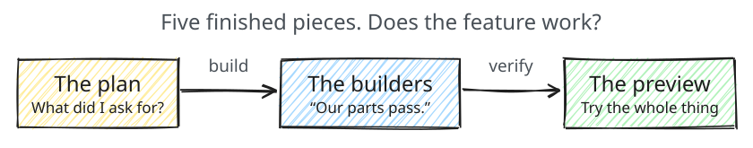
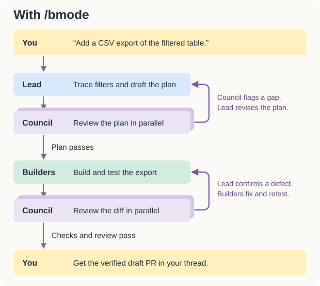

# Why I built bStack

Before I worked with AI agents, implementing a feature had a rhythm. Say I was adding CSV export to a table. I might spend twenty minutes figuring out which rows belonged in the file. Just the ones on screen? Everything that matched the filters? Where did the app actually make that distinction?

Once I’d figured that out, I could coast for a bit. Wire up the button. Reuse the existing query. Open the downloaded file and see how it looked. I was still coding, but I could go a few minutes without making another difficult decision. Those were little mental breaks. I barely noticed them until they disappeared.

When I started using agents, those stretches were the easiest to hand over. An agent could wire up the button while I did something else. Naturally, the first thing I did with that free time was open another thread.

## Every tab had saved its hardest bit for me

I’d switch to the first thread because it had a question about the export format. The second had a diff ready, so now I was reviewing code. In the third, a test was failing and I needed to remember why we’d picked that design in the first place. The clankers got the easy bits. Somehow I’d promoted myself to doing the hard bits of four jobs at once.

For a while I thought I just needed to get better at supervising. I’d work out the solution before writing the prompt, check the plan as soon as it appeared, and catch mistakes early. That worked reasonably well with one thread. With several, I had to keep every half-finished feature in my head because any one of them might need its next instruction.

I was tired all the time. I’d get headaches. Sometimes I felt nauseous. It was a pretty miserable way to feel doing work I normally enjoy, especially because, on paper, things were going well. Features were getting built. PRs were going up. Looking at what I shipped in a week, you’d have had no idea how rough I felt doing it.

The bit that wore me down was deceptively small. A thread would ask, “Does this look right?” Before I could answer, I had to remember what we’d agreed on, which approach we’d ruled out, and whether this was the feature with the weird edge case. By the time I had enough of the problem back in my head to give a decent answer, another thread was ready for me.

That’s why a study from Berkeley stuck with me. The researchers spent eight months observing work at one tech company. They saw people running AI tasks during meetings and letting work creep into their breaks. In a separate BCG survey, people who spent more effort overseeing AI reported more fatigue. I recognized my own habit in both. Give me ten minutes back and apparently I’ll fill them with another agent to supervise. [Berkeley researcher interview](https://www.universityofcalifornia.edu/news/ai-promised-free-workers-time-uc-berkeley-haas-researchers-found-opposite) · [BCG research in Harvard Business Review](https://hbr.org/2026/03/when-using-ai-leads-to-brain-fry)

## The video that changed how I work

Watching Theo’s *If you have a Claude sub, watch this* was the breakthrough for me. Up to that point, I’d sat down to solve a bug and brought in an agent once I knew which function needed changing. I thought that was what a good prompt looked like. Around 33 minutes in, Theo talks about handing the agent the problem while there’s still something to figure out. I remember thinking about all those half hours I’d spent tracing a bug just so I could tell a very capable model which three lines to write. What would it have found if I’d given it the bug report when I first opened it? [Theo on giving the agent the problem, 33:00–37:00](https://youtu.be/D8PikZ1KhUo?t=1980)

The other part that stuck with me came later, when he talked about what you want to find the next time you open the thread. I knew exactly what I wanted: a fix I could try, a draft PR, and a way to see that the original bug was gone. So why was I asking for a plan and setting myself up to come back twenty minutes later just to type “go ahead”? I’d put that interruption there myself. [Theo on following the work through delivery, 45:00–48:00](https://youtu.be/D8PikZ1KhUo?t=2700)

That video changed when I open a thread and what I ask for in the first message. Now I’ll hand over the bug as soon as I can describe what went wrong. If I know something the agent couldn’t reasonably discover, like a promise we made to a customer, I include it. Then I tell it what I want to come back to. It can figure out where to look, follow a lead I’d have missed, and try the fix. That left me with a question I ended up building bStack around: how much of the work between that first message and a PR actually needs me?

## The swarm idea had been sitting there for a while

I remember reading about Agent Swarm when Kimi K2.5 came out. You could give it one task, and an orchestrator would decide how to split the work, send up to 100 agents off to tackle different parts, and bring their results back together. A hundred agents! I thought that was ridiculously cool. Then I went straight back to copying findings between three chat windows. It took me a while to actually try the idea myself. [Kimi’s Agent Swarm announcement](https://www.kimi.ai/blog/agent-swarm)

What intrigued me, beyond the frankly silly number of agents, was that the person using it still got to have **one conversation**. One agent could be responsible for figuring out who needed to do what. I’d been doing that job myself without ever deciding it was a good use of my day.

Before I started experimenting in T3 Code, I tried Cursor Projects. You talk to a coordinator about a feature. It can send an agent to investigate how something works, then use those findings to brief the agents building and testing the change. They share project files, so if somebody figures out how to run a particularly annoying test, the next agent can pick up the instructions. The project runs on its own machine. You can close your laptop and the work carries on. [Introducing Cursor Projects](https://cursor.com/blog/projects)

I loved that. Up to then, if one agent discovered something the others needed, *I* was the integration. I’d copy the finding, switch tabs, paste it into another conversation, then try to remember what I’d been doing in that tab before I interrupted myself. With Projects, I could tell the coordinator what I wanted and let it handle the conversations behind it.

After a while, Projects felt a little restrictive for the experiments I wanted to run. I’d got curious about the coordinator’s job itself. What if an agent from a different lab challenged the plan before anybody wrote code? If two reviewers disagreed, could the lead settle it by checking the code? Could it be the one to ask “did anybody actually try this?” before the result landed back in my lap? That’s what I took into T3 Code.

## A few things I tried

One experiment was to let the agents do the research and bring me a written plan. Go read the code, look at the alternatives, figure out how many PRs the change would take. That gave me something concrete to challenge before anyone spent hours building the wrong thing. It also gave me a 4,700-word plan to read. Turns out you can delegate the research and still assign yourself homework.

I ended up asking for a short proposal I could follow in one sitting, with the implementation detail in a separate file. Both documents had a reader now. I could look at the proposal when I wanted to weigh in on the feature. The builder had the details it needed to get on with the work.

I also tried having several agents review the same plan independently. I kept doing this because one model would sometimes get hung up on exactly the assumption another had sailed past. I learned how easily a review could drift, too. On one feature, I’d asked for a design that covered every source system. Somewhere in the revisions it narrowed to just one. Every reviewer could have agreed on that plan and we’d still have built the wrong feature. Somebody had to keep the original request in view and check each proposed change against it.

Then I tried handing out more of the implementation. On a batch of six bugs, I gave each ticket its own T3 thread and put one agent in charge of briefing the others and checking their work. On another feature, I had five builders working in one checkout. With that much happening in parallel, “done” became a suspiciously interesting word. Five agents could each finish their part and I’d still have a fairly basic question. Had anybody tried the whole thing?

So I started asking for evidence I could use. Run the case that failed. Try the change in the preview deployment. If there are 29 cases, tell me what happened on all 29. That changed what I could do when I sat down to review. I could open the feature, try the part I was unsure about, and make a call without reading an afternoon’s worth of chat history first.

What finally clicked was reading back through my own messages. Across different features I kept typing some version of “go research it,” “have the others challenge the plan,” “keep going,” “build it,” “did you test it end to end?”, and “open the draft PR.” On one feature we went through eight rounds of plan review and seven rounds of code review. Some of my messages changed what we built. Quite a few existed because the agents were waiting for me to tell them which step came next.

That was the part worth turning into bStack. I wanted to keep the research, the disagreements, and the checks on the real thing. I also wanted to be able to go eat lunch somewhere between steps four and five.

## What the swarm does

In bStack, the **swarm** is the team of AI agents working on your request. The lead is the one you talk to in T3 Code. It’s responsible for understanding what you asked for, organizing the work, and bringing the result back to that same thread. I usually give that seat to a current frontier model. Keeping the whole problem straight and knowing when another agent has made a convincing but irrelevant point is a job I’ll spend extra capability on. My pick changes as the models do. [Slopalytics](https://slopalytics.com/)

For reviews, I like using agents from different labs. Each model has its quirks. One might follow a query through every caller. Another might read the original request and ask why a requirement disappeared halfway through the plan. They get an independent first look. Then the lead checks their objections against the code, revises what needs work, and gives the next round the findings and the reasoning behind each change.

Here’s how that plays out with the CSV export. I type `/bmode Add a CSV export of all rows matching the current filters`. That’s the request. I don’t know where the filter lives or how the table loads its data. Finding that out is part of the job I’ve handed over.

One agent traces the query and discovers that the screen loads 50 rows at a time. Another looks at the existing export tests and finds that every example fits on one page. Those findings are more useful together. A reviewer asks, “What happens when 500 rows match?” The lead adds that case to the plan. When the builders run it, they can open the file and count the rows. If they get 50, they have a reproducible bug. They fix it, run it again, and give the reviewers the result.

That’s the part of swarms I still find cool. Nobody needed the whole answer up front. Two agents looking in different places found a gap, a third pulled their findings together, and the team could settle the question by trying the feature. I get a better export out of it without having to remember, halfway through lunch, that I should probably ask about pagination.

The lead proposes a plan. Reviewers look for gaps, and the lead revises it. Once the plan passes, builders implement and test it. Reviewers inspect the diff and send confirmed defects back for fixes. The lead returns the verified draft PR to the thread where you asked for it.

Sometimes the right move is to come get me. If I’d just said “export the table,” and the team found two equally plausible interpretations with different consequences for customers, I’d want to hear about that. Show me what you found and give me your recommendation. Choosing what we promise the customer is worth my attention. Counting the rows in a CSV is a job the swarm can finish.

## The agents can wait

I use this setup in two ways. Sometimes I **want to work through a problem with an agent**. I might have a rough feature idea and genuinely have no clue what it should feel like to use. I’ll stay in the thread, ask to see two versions, try them, and change my mind. I enjoy that part. My attention is doing something useful there. We’re figuring out what to build.

Other times I **want to hand over a problem**. I know what I want and can describe what a good result looks like. That’s when I start `/bmode` and leave. The team can spend the next hour investigating, building, and reviewing. I can spend that same hour on one thing that needs my full attention. The lead comes back with a verified draft PR, or it comes back earlier because it’s stuck and can tell me exactly what it needs.

Yes, a swarm uses more tokens and can cost more money. With paid plans for Claude, Codex, and Cursor, though, using ten or more agents on a feature is within reach. An agent that answers one narrow question might finish in minutes. Ten long-running sessions on expensive models are a different proposition. I pick the model and the size of the job with the plan’s allowance in mind. [Claude usage limits](https://support.claude.com/en/articles/14552983-models-usage-and-limits-in-claude-code) · [Codex usage limits](https://help.openai.com/en/articles/20001625-understanding-chatgpt-and-codex-usage-limits) · [Cursor plans](https://cursor.com/docs/account/pricing)

My rule these days is simple: **if tokens can settle the question, spend the tokens.** Let another agent trace the query. Run the failing case. Give the revised code to a fresh reviewer who hasn’t spent the last hour convincing itself that its own implementation is correct. That’s why the swarm works in loops. Each pass should bring back something the previous one didn’t have. Once the checks pass and the reviewers have no outstanding findings, bring me the PR. If another round would only repeat a question that needs my judgment, bring me the question.

Tokens are cheap compared with what burning myself out was costing me. A quick interruption can look free from the outside. I type a sentence and the agent carries on. The expensive part is getting my head back into that feature, then back into whatever I put down to answer it. Do that enough times and the bill shows up later, when I finally sit down with a decision that really does need me and I’m too tired to give it a proper read.

And if three draft PRs are ready when I get back from lunch? Fine. I’ll open the first one, try the feature, and take my time deciding whether I’d ship it. The other two can wait.
