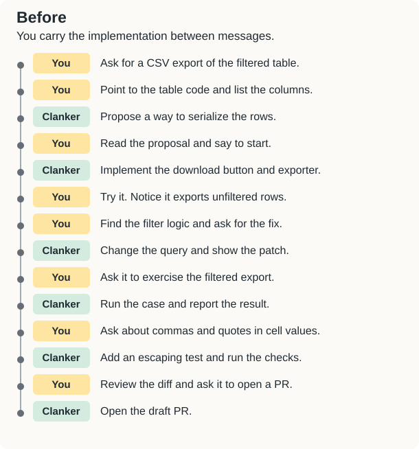
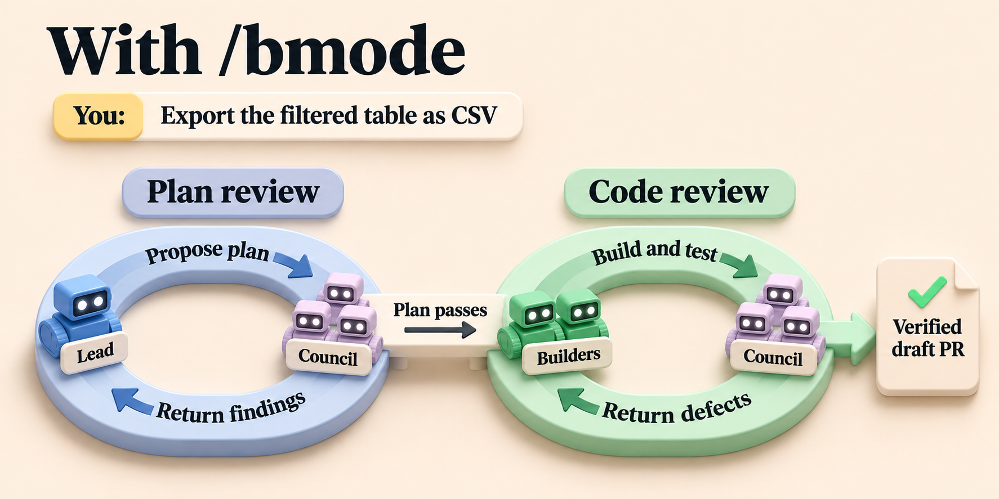

# Philosophy

Your attention is the scarce part of working with clankers. If every question about the code comes back to you, you still have to hold the whole problem in your head.

Start `/bmode`, give it the problem, and go do something else. The lead brings you back when a decision needs your judgment or the result is ready for review.

Suppose you want a CSV export of the filtered table.

The lead coordinates a council of clankers. Each reviewer gets a first look at the plan. If one flags a problem, the lead checks it against the code and carries the objection, its reasoning and any revision into the next round. The builders take the reviewed plan through implementation and verification. The council reads the resulting diff, and the lead sends confirmed defects back for fixes. You get the draft PR in the thread where you asked for it.

## Why interruptions matter

At one tech company, Berkeley researchers saw people keep several AI tasks going while reviewing code or sitting in meetings. Work also crept into their breaks. In a separate BCG survey, workers who spent more effort overseeing AI reported more mental fatigue. Interruptions have a cost even when the work looks fine. In Gloria Mark and colleagues’ email experiment, interrupted participants worked faster and kept up the quality of their answers, but felt more stress and time pressure. [Berkeley][berkeley] · [BCG][bcg] · [Interruption study][interruptions]

There’s still a reason to review the result. Workers in a Carnegie Mellon and Microsoft survey described spending their judgment on checking information and deciding how to use it. In a Harvard and Łódź experiment, people who had to think through AI advice were less likely to accept a wrong answer, though they liked the most effective designs least. And in a Harvard Business School field experiment, GPT-4 helped consultants do better work on some tasks and made them less likely to get another task right. [Critical thinking][thinking] · [Checking advice][checking] · [Consulting experiment][frontier]

## When to step in

I used to hand over a task with the solution already worked out. Now I give the clanker the problem and enough room to investigate. A model can follow a lead I missed and find a cause I didn’t know about. If I’ve already told it which line to change, it has little reason to look.

The clanker is responsible for noticing when it is stuck. If it keeps trying the same fix, it should investigate another lead. If it reaches a choice only you can make, it comes back with what it tried, the choice, and its recommendation. Your job is to frame the problem, set the boundaries and judge the result. Theo describes giving the agent the problem at [33:00–37:00](https://youtu.be/D8PikZ1KhUo?t=1980) and following the work through delivery at [45:00–48:00](https://youtu.be/D8PikZ1KhUo?t=2700).

## What the clanker owns

A bug report should come back with the failing case and a fix that passes it. A UI change should come back with evidence from the UI. When you ask for a PR review, you get a verdict up front and a failure scenario for each defect. You decide which comments to post.

While your PR is a draft, the clanker follows your review comments, checks its fixes and pushes them. If another reviewer raises a point, it brings you a recommendation. Once you mark the PR ready, it waits for your decision before changing the code. Posting a reply, resolving a thread, or merging takes your explicit instruction.

Keep each skill small enough to fork. Say what the outcome is, where the agent's authority ends and how to check the result. Add a rule when you can name the failure it prevents.

## References

- Ranganathan and Ye. [AI Doesn’t Reduce Work—It Intensifies It][berkeley].
- Bedard and colleagues. [When Using AI Leads to “Brain Fry”][bcg].
- Mark, Gudith and Klocke. [The Cost of Interrupted Work][interruptions].
- Lee and colleagues. [The Impact of Generative AI on Critical Thinking][thinking].
- Buçinca, Malaya and Gajos. [To Trust or to Think][checking].
- Dell’Acqua and colleagues. [Navigating the Jagged Technological Frontier][frontier].
- Theo. [If you have a Claude sub, watch this](https://youtu.be/D8PikZ1KhUo).

[berkeley]: https://hbr.org/2026/02/ai-doesnt-reduce-work-it-intensifies-it
[bcg]: https://hbr.org/2026/03/when-using-ai-leads-to-brain-fry
[interruptions]: https://www.ics.uci.edu/~gmark/chi08-mark.pdf
[thinking]: https://www.microsoft.com/en-us/research/wp-content/uploads/2025/01/lee_2025_ai_critical_thinking_survey.pdf
[checking]: https://iis.seas.harvard.edu/papers/2021/bucinca21trust.pdf
[frontier]: https://doi.org/10.1287/orsc.2025.21838
